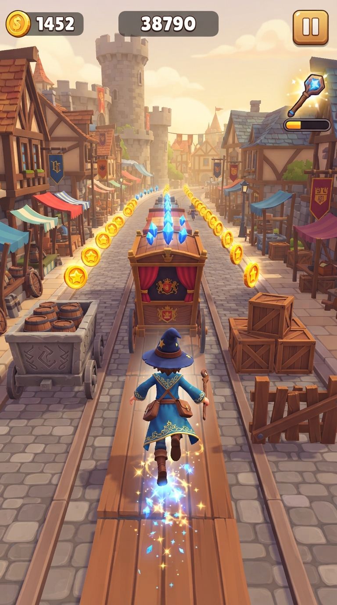
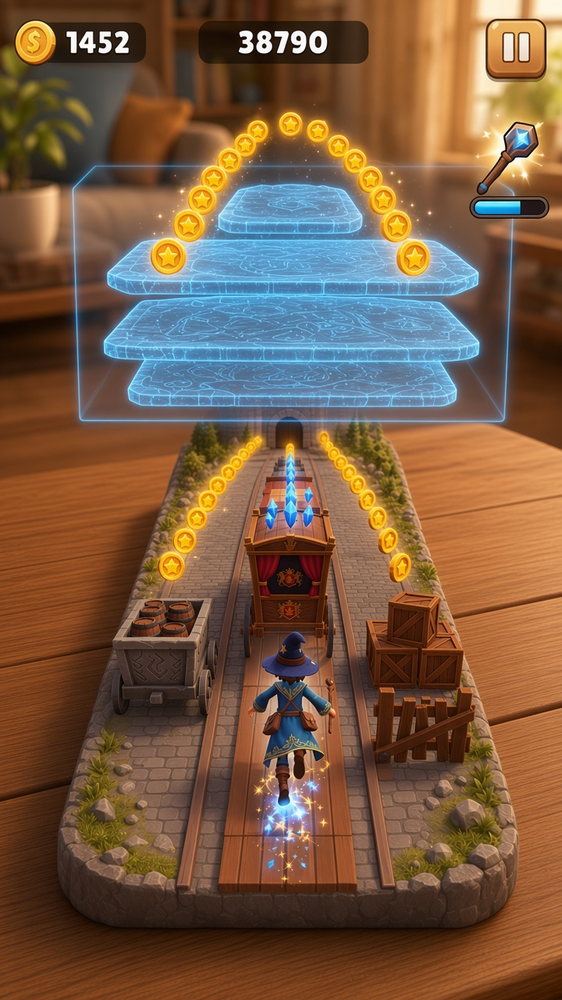

# Mage Run: design doc

Status: **concept / pre-production**. No game code yet. This document is the
plan for a medieval fantasy three-lane endless runner on the Looking Glass
platform, plus the platform work it needs (per-game screen orientation and
screen-space swipes).

*`docs/mage-run/reference.jpg` is a **style reference only**, picked by the
user as the target look. It is not a shipped asset and must not be packaged,
traced or used as a texture. Every shipped model, texture and sound is made in
code or comes from a CC0 source (see [Assets and licensing](#assets-and-licensing)).*

*`docs/mage-run/concept-combined.jpg` is a generated concept mockup of the chosen direction (solid storybook world plus hologram upper rows). Mood only, not to scale; in-game the hologram rows sit directly above the road lanes.*

---

## 1. Concept

A wizard in a blue robe and a starry pointy hat runs down a cobblestone and
plank road on a small **storybook diorama** that sits on the player's real
table or floor, away from the player toward a stone castle at the far end.
Royal carriages, crates, barrel mine-carts and wooden fences stream toward
the player. The player dodges them with fast swipes (left / right to change
lane, up to jump, down to slide) and grabs gold star coins. As the run goes
on, **glowing cyan hologram rune-stone platforms** appear *above* the solid
road. They are new rows of lanes, so the run gets taller as well as faster.
Coin lines arc up onto them (risk and reward: the high line pays more but
the platforms can collapse).

The pitch in one line: *Subway Surfers timing, on a tabletop diorama, with
hologram floors that stack up the further you get.*

Pillars:

1. **Swipe timing first.** Inputs are buffered and forgiving, and every
   obstacle shows clearly what it needs (jump, slide or a lane change).
2. **Readable at table size.** The whole run fits in a small play box seen
   from about 0.5-1 m away; silhouettes and colour do the work, not detail.
3. **Solid world, hologram rows.** The opaque warm diorama is the ground
   truth; translucent cyan rows are clearly "magic" and clearly a different
   floor.
4. **The room stays visible.** No side rows of houses, no skybox walls: it is
   a diorama in your room.

---

## 2. Board, box and placement

### Footprint and orientation

- The road runs along the board's **long axis, away from the player**
  (board space -Z is "ahead", toward the castle; +Z is the near end where the
  wizard runs, toward the player).
- **Suggested `board_size`: 0.30 m x 0.60 m** (x = width, z = depth) at
  placement scale 1. On a table that is a 30 x 60 cm diorama. On the floor
  the player scales it up (the platform's placement scale), for example x3
  to 0.9 x 1.8 m.
- The road (3 lanes) is about 0.22 m wide, on a rounded stone base 0.28 m
  wide, leaving a thin margin of base and grass to the footprint edge.

### Play box

- Manifest uses **`tall_box = true`**: the cap is `min(3.0 m, 4 x long side)`
  = 2.4 m for a 0.6 m board. Mage Run does not need that much; it wants
  headroom for 2 hologram rows and jump arcs.
- **Suggested airspace: `box_height` 0.40 m, `box_min_height` 0.30 m,
  `box_max_height` 0.70 m.** Rows sit at fixed fractions of the default
  layout (see section 3), so a lower box only trims the sky above the top row
  (the castle top, particles).
- `board_height` about 0.35 m (camera framing in "Play without AR").
- `box_outline_while_playing()` returns about **0.15** (at most a faint
  outline; the brief asks for at most that).

### Streaming and the box edge

- The world is a treadmill: the wizard stays near the **near third** of the
  board (z about +0.18 m) and the world scrolls toward +Z.
- Content spawns at the far end (z about -0.30 m, behind the castle gate)
  and is removed at the near end (z about +0.30 m).
- **Dissolve at the box edge:** solid props fade and shrink over the last
  4 cm before the near edge and the first 4 cm after spawning: a dither or
  alpha ramp in the solid shader, with a cyan "dissolve" rim so it reads as
  magic, not popping. Hologram platforms fade their intensity the same way.
  Nothing is ever drawn outside `PlayBox.contains()` (tests assert this, as
  with Stack Tower debris).
- The **castle** is a fixed backdrop at the far end, inside the box,
  slightly scaled down (forced perspective). The road appears to run into its
  gate, which hides the spawn point.

### Placement flow

- The standard Looking Glass calibration: trace or pick a surface, fit
  edges, adjust the airspace, lock. Mage Run adds nothing.
- The default rotation puts the far end (castle) **away from the player**:
  the board's -Z faces away from the camera at Lock. If the player rotated
  the board, the game still runs along board -Z (the player chose the view).
- Recommended AR viewing: phone in **portrait**, held at chest height, about
  0.6-0.9 m from a table diorama, looking down 25-40 degrees.

---

## 3. Lanes and rows

### Ground (row 0)

- 3 lanes, x = -0.075, 0, +0.075 m (lane pitch 0.075 m at scale 1).
- The wizard's collision capsule: radius 0.022 m, height 0.06 m (a 6 cm
  wizard on a table).

### Hologram rows (rows 1-2; row 3 optional)

- Rows are **translucent cyan rune-stone platforms** made of tiles (one tile
  per lane per segment, about 0.075 x 0.10 m), floating above the road.
- Heights: row 1 at **+0.10 m**, row 2 at **+0.20 m** (row 3, if used, at
  +0.30 m; it needs the 0.40 m default box).
- **Unlock by distance** (in metres run, world units at scale 1; tuned in
  playtests):

  | Distance | Unlocks |
  | --- | --- |
  | 0 m | Ground only |
  | 150 m | Row 1 segments start appearing (short, 2-4 tiles long) |
  | 400 m | Row 1 long runs; row 2 segments start |
  | 800 m+ | Rows 1-2 common, multi-row coin arcs, collapsing platforms |
  | (option) 1500 m | Row 3 |

- Rows are **not continuous floors**. They are segments over parts of the
  road, so the ground stays the default.

### Reaching and leaving rows

| Way up / down | How it works |
| --- | --- |
| **Swipe up under a row** | A jump from row N reaches row N+1 if a platform tile is overhead in that lane during the jump's top window (the jump apex is tuned to clear exactly one row: about 0.11 m). |
| **Ramps** | A glowing rune ramp on row N leads up to row N+1. Running onto it lifts the wizard automatically, with no input needed. |
| **Levitation power-up** | Lifts to the highest unlocked row for its duration (see power-ups). |
| **Swipe down on a row** | Drops to the row below (a short fall, then a landing squash). On the ground, swipe down is a slide. |
| **Run off the end** | When a segment ends, the wizard falls to the row below and lands safely. Falling is never a death by itself. |
| **Collapsing platforms** | Cracked tiles (a flickering, red-tinted rune) crumble 0.4 s after the wizard steps on them, dropping them a row. They are marked and always used for risk-reward (coins on them). |

Fairness rule: a row segment never ends directly above an obstacle that the
falling wizard cannot avoid. There is at least 0.25 s of clear ground
(at current speed) under every segment end.

### Camera and readability of rows

- In AR the player's own phone is the camera. Rows are spaced 0.10 m apart
  so that, at a typical 30 degree look-down, each row is visibly offset on
  screen.
- A soft cyan **drop shadow / rune ring** is projected onto the road under
  the wizard when on a hologram row, so depth reads.

---

## 4. Controls

### Gestures

| Swipe | Ground | On a hologram row |
| --- | --- | --- |
| Left / right | Change lane (0.12 s lateral move) | Change lane (only onto a tile; otherwise a blocked "bump" and stay) |
| Up | Jump (apex 0.11 m, 0.55 s airtime at base speed) | Jump (can reach the next row) |
| Down | Slide (0.6 s, low capsule) | Drop to the row below |
| Tap | (AR: nothing; see disambiguation) | Same |
| Double-tap / staff button | Fire the staff power-up when the meter is full | Same |

### Swipe detection (screen space)

Swipes are read in **screen space**, not board space: a runner's input must
not depend on where the board is on screen or on the AR camera angle.

- A swipe is a single-finger stroke whose displacement passes
  **`SWIPE_MIN = 0.28 in`** (inches, converted with the screen DPI the way
  GameHost already sizes its tap slop: about 45 px at 160 dpi, about 120 px
  at 420 dpi) **within `SWIPE_MAX_TIME = 0.25 s`** of touch-down.
- The direction is the dominant axis, if it is **at least 1.4x the other
  axis**. Otherwise it waits until it is (diagonal strokes resolve as soon as
  they lean far enough).
- **Fire on threshold, not on release:** the swipe triggers as soon as it
  crosses the threshold, so fast players are not delayed by lift-off. The
  rest of that stroke is ignored (one swipe per stroke), unless the finger
  reverses by another full threshold (an "S" stroke = two swipes, allowed
  for left-right corrections).
- Directions are mapped **relative to the screen in its current
  orientation**: up is toward the top of the screen as held, after rotation
  (see section 9).

### Timing windows and buffering

- **Input buffer: 0.15 s.** A swipe that arrives while an action cannot
  start (mid-jump, mid-lane-change) is queued and fires the moment it can,
  if still within 0.15 s.
- **Coyote time: 0.08 s.** A jump just after running off a platform edge
  still counts as jumping from it.
- **Lane-change cancel:** swiping the opposite way mid-change reverses it
  (no buffer needed).
- **Jump to slide:** swiping down mid-jump "slams" down fast (0.12 s) and
  then slides (Subway Surfers feel).
- All timing is in **game time** (paused with `_on_paused`, scaled by
  speed where noted); swipe detection uses real time.

### Swipe vs AR tap disambiguation

- While playing, Mage Run **captures all single-finger strokes** (a new
  `captures_swipes()` hook, see section 9). The platform does not use them
  for camera orbit.
- A touch that ends within the tap slop and under 0.25 s is a **tap**.
  Taps do nothing in the run (no accidental actions), except on HUD buttons
  (pause, staff), which are game UI (`is_over_game_ui`) and never reach the
  board.
- Two fingers are never a swipe (pinch stays reserved; the run ignores it,
  and outside AR the platform may zoom).
- During calibration, Adjust and the unlocked state, the platform owns touch
  as today; the game sees no input (`is_playing()` is false).
- An optional **"Tap to jump" accessibility setting** (open question)
  would map taps to jump, using the left / right third of the screen for
  lane changes.

---

## 5. Obstacles, coins and power-ups

### Obstacle types

Each obstacle needs exactly one answer, shown by its shape:

| Obstacle | Answer | Look |
| --- | --- | --- |
| **Wooden fence** (low, 1 lane) | Jump | Brown posts and rails, about 0.035 m high |
| **Hanging banner / beam** (1 lane) | Slide | A wooden beam on two posts with a royal blue banner |
| **Crate stack** (1-2 lanes, tall) | Change lane | Stacked crates, rope-bound |
| **Barrel mine-cart** (moving) | Change lane (it rolls toward you, faster than the road) | Wooden cart full of barrels, on a short rail stretch |
| **Royal carriage** (2 lanes wide, tall) | Change lane, or jump onto its roof (a "platform" obstacle) | Gold and white carriage with blue crystals; the roof is walkable |
| **Rune gap** (hologram rows only) | Jump, or drop | A missing tile |
| **Cracked rune tile** | Do not stop on it (crumbles after 0.4 s) | Flickering red-tinted rune |

Collision rule: hitting the front of a blocking obstacle ends the run
(unless shielded). Clipping the side during a lane change "stumbles":
a short slow-down, and two stumbles in 3 s end the run (Subway Surfers'
forgiveness).

### Coin lines and risk-reward

Gold star coins (spinning, about 0.02 m) come in lines of 5-12:

- **Straight line** in a lane (safe, low value).
- **Lane weave** (a curve across lanes) that teaches lane changes.
- **Jump arc** over a fence (coins at the apex reward good timing).
- **Ramp arc** from the ground up onto a hologram row (the main risk-reward:
  up there coins are worth **x2 on row 1 and x3 on row 2**, but tiles may
  crack and segments end).
- **Carriage roof run**: coins along a carriage's roof (reached by jumping
  on it).
- **Bait line**: a line ending at an obstacle with a timed escape (only at
  higher difficulty, always escapable with the reaction time below).

Rule: **a coin line never requires an impossible input.** Each line is
built from the same input-timing model as the obstacles (section 6).

### Staff power-up meter

- The HUD's **staff meter** fills with coins (each coin +1, a full meter is
  50) and with "perfect dodges" (a near-miss lane change: +3).
- When full, the staff glows. Double-tap the screen or tap the staff icon to
  cast. The power-up cast is picked by the run state, or the player cycles it
  with a long press (open question).

| Power-up | Effect | Duration |
| --- | --- | --- |
| **Magic shield** | A blue bubble absorbs one crash | 12 s or 1 hit |
| **Coin magnet** | Coins within 1.5 lanes fly to the wizard | 10 s |
| **Levitation** | Floats to the highest unlocked row; tiles cannot crack under the wizard; the drop at the end is safe | 8 s |
| (later) **Blink** | Passes through the next obstacle | 1 use |

Rare **field pickups** (a floating rune) give an instant power-up without the
meter, as in Subway Surfers.

---

## 6. Difficulty and procedural generation

### Speed curve

- Base speed **1.2 m/s** (world units; on a 0.6 m board, one board length
  every 0.5 s), rising to **2.6 m/s** at about 2000 m:
  `speed = 1.2 + 1.4 * (1 - exp(-distance / 900))`.
- Spawn density, obstacle mix and row frequency step up at the distance
  thresholds in section 3.

### Chunks

- The road is built from **hand-authored chunk templates** (data, not
  scenes), 1.2-2.4 m long each (2-4 board lengths). A chunk is a grid of
  `lane x row x slot` (slot = 0.10 m) with obstacle, coin-line, ramp and
  tile entries.
- Templates are tagged: difficulty band (1-5), rows used (0 / 0-1 / 0-2),
  and an "entry lane set" and "exit lane set" (which lanes are safe to be in
  at its start and end).
- The generator picks the next chunk from the current band, whose entry
  lanes include at least one exit lane of the previous chunk. It also mirrors
  chunks left / right at random, for variety.
- A **seeded RNG** per run (seed shown on the game-over screen, for bug
  reports and a future "daily run").

### Fairness rules (enforced by a validator, unit-tested)

1. There is **always at least one safe path** through every chunk *and*
   across chunk joins. The validator walks a lane x row state machine with
   the player's actual move set and timings at the chunk's max speed.
2. **Reaction time:** a new obstacle is fully visible (out of the spawn
   dissolve) at least **0.75 s** before the wizard reaches it at current
   speed. At 2.6 m/s that means it is solid 1.95 m ahead, so on a 0.6 m
   board the far spawn must sit at least 3 board lengths of world distance
   ahead. The treadmill compresses this visually: see the *open question* on
   world-to-board scale.
3. **At most two consecutive inputs** required within 0.35 s.
4. **No blind lane changes:** a lane is never blocked in a way only visible
   from directly behind.
5. **Hologram segments** end over at least 0.25 s of clear ground.
6. **Cracked tiles** only appear with an intact tile within one lane change.
7. **No unbeatable coin lines** (section 5).

### World scale vs board scale

The gameplay world is measured in "run metres", and the board shows a
window onto it. Proposal: **1 run metre = 0.25 m of board depth** at
placement scale 1. The 0.6 m board then shows 2.4 run metres, and the
speed numbers above are in run metres per second. This keeps reaction
distance fair without a huge board (see open questions).

---

## 7. Scoring

- **Score** = distance (run metres) x **multiplier**, plus coin bonuses.
- **Multiplier**: starts at x1; +1 for each mission or "streak" (for
  example 20 coins without a stumble), up to x5 for the run. Also x2 while
  on row 1 and x3 on row 2, applied to coins only.
- **Coins** are counted separately (a currency for future cosmetic unlocks:
  hats, robe colours, trail colours).
- **Session best** and an all-time best (saved to `user://`, unlike the
  session-only bests in the other sample games).
- Game over: distance, coins, score, best, seed, with **Restart** and
  **Back to games**.

---

## 8. Art direction

### Look: solid storybook diorama + hologram rows

- **Solid** (the default for the world): opaque, softly lit, stylized
  low-poly with warm colours: cobblestones (grey-beige), planks (honey
  brown), a rounded grey stone base with moss green edges, a gold and white
  carriage with blue crystals, red-brown crates, dark barrels, a light grey
  stone castle with blue-slate roofs.
- **Hologram rows**: translucent, additive-glow cyan rune-stone tiles using
  the platform's Holo kit (`Holo.material`, edge lines, scanlines and
  sweep) with carved rune glyphs (procedural decals) and a soft flicker.
  They are the only see-through elements in the scene, which keeps the two
  layers distinct.
- **Wizard**: a blue robe, a dark blue pointy hat with gold stars, a white
  beard, a staff with a glowing tip, and a **blue sparkle trail** (a CPU
  particle ribbon behind the feet, using `HoloSplash`-style additive motes).
- **No side rows of houses**, no walls or skybox. Beyond the stone base it
  is the real room (AR camera image) or the platform's plain backdrop
  outside AR. The castle is the only tall prop, at the far end.
- **At most a faint box outline** (about 0.15) while playing.

### Ties to the Hologram / Solid style system

Stack Tower introduced a per-game **Hologram / Solid** style toggle
(`StackTowerGame.Style`, `session_style`). Mage Run reuses the idea with a
different split:

- **World props**: Solid by default. A "Hologram world" option renders
  props with `Holo.material` for players who want the all-hologram look.
- **Upper rows**: always Hologram (gameplay meaning: "magic floor").
- Proposal: lift the style enum and the material helpers (`solid_material`,
  outline hull, `holo_material`) from Stack Tower into
  `platform/visual/` (for example a `HoloStyle` helper), so both games share
  them.

### Budget (mid-range Android, gl_compatibility)

Target device: a 2021-2022 mid-range phone (Adreno 610-619 / Mali-G57
class) at 60 fps, with ARCore camera passthrough already costing a share
of the GPU.

| Item | Target |
| --- | --- |
| Draw calls (3D, visible) | **<= 120** (hard cap 160) |
| Triangles on screen | **<= 60k** (hard cap 90k) |
| Wizard | <= 2.5k tris, 1 material (vertex colours), simple bone or procedural animation |
| Prop | 100-800 tris, vertex colours, no unique textures |
| Road chunk | Merged into one mesh per chunk (cobbles + planks + base), <= 3k tris |
| Coins | One `MultiMeshInstance3D` for all coins (1 draw call) |
| Hologram tiles | One `MultiMesh` per row (1-2 draw calls), additive, no depth write |
| Particles | CPUParticles3D only (trail <= 40 motes, coin sparkle <= 24) |
| Textures | At most one small shared atlas (256-512 px) for rune glyphs and the star decal; everything else is vertex colours |
| Lights | The host's sun + ambient; no shadows from props (a baked blob shadow quad per moving object) |
| Post-processing | None (no glow pass in gl_compatibility); "glow" comes from additive materials |

### Assets and licensing

- All models are **built in code** (like Tattoo Studio's procedural bodies
  on the `3d-model-game` branch, and Stack Tower's blocks): boxes, cylinders, lathed profiles and
  extrusions with vertex colours.
- Optional **CC0** packs (for example Kenney's CC0 medieval and fantasy
  kits) may be used for props, kept as glTF under
  `games/mage_run/models/` with a `LICENSES.md` entry per file (source URL,
  author, CC0 statement).
- **No copyrighted assets**, no assets from Subway Surfers or other games,
  and the reference image is never shipped.

---

## 9. Audio notes

- The platform has no audio yet. Mage Run would be the first game with
  sound, so it needs a small `platform/audio/` helper (bus setup, a pause
  hook that mutes on `_on_paused`, and respect for the phone's silent mode
  where possible).
- SFX (CC0 or synthesized in code): footsteps on cobbles and planks
  (alternating), lane whoosh, jump "hup" plus a cloth flap, slide scrape,
  coin chime (pitch rising along a line), hologram row hum and step "ting",
  tile crack, crash thud, power-up cast (staff sparkle), shield pop.
- Music: a short looping medieval folk tune (CC0 or commissioned later) with
  a second layer that fades in on hologram rows.
- Budget: OGG Vorbis, mono SFX, <= 1.5 MB total; at most 8 voices.

---

## 10. Platform work required

### 10.1 Per-game orientation

- **Manifest**: `@export_enum("landscape", "portrait", "either") var
  orientation: String = "landscape"` on `LGGameManifest` (validated).
  Mage Run declares `portrait`. Tic-Tac-Toe, Stack Tower and Tattoo Studio
  keep `landscape` (or become `either` once their HUDs are checked).
- **Launcher / catalog**: stays landscape (or `either`).
- **Applying it**: `GameHost` calls
  `DisplayServer.screen_set_orientation()` on game load and restores the
  launcher's orientation on exit:
  - `landscape` -> `SCREEN_SENSOR_LANDSCAPE` (both landscape directions)
  - `portrait` -> `SCREEN_SENSOR_PORTRAIT`
  - `either` -> `SCREEN_SENSOR`
- **Android export**: today `project.godot` has
  `window/handheld/orientation=0` (landscape, locked). Change the project
  default to **sensor landscape** (`4`, `SCREEN_SENSOR_LANDSCAPE`; `5` is
  sensor portrait, `6` full sensor) so the
  Activity allows runtime changes. Check that the generated
  `AndroidManifest.xml` `screenOrientation` and `configChanges` include
  `orientation|screenSize`, so Android does not restart the Activity. That
  would kill the AR session; Godot's template already declares this, but it
  must be verified in the exported APK (`aapt dump xmltree`).

### 10.2 Smooth rotation

- **Viewport**: `window/stretch/mode="canvas_items"` with
  `aspect="expand"` already adapts to any aspect ratio. On
  `get_viewport().size_changed`:
  - **HUD rebuild**: platform HUD (back button, status label, calibration
    HUD, AR debug) and game HUDs re-layout from anchors. Tattoo Studio's
    `TattooStudioUI.layout()` (on the `3d-model-game` branch) already
    listens to `size_changed`; the others
    are anchored Controls. Each HUD gets a portrait layout pass (for
    example, Tattoo Studio's side panels become a bottom tray).
  - **A short cross-fade** (0.25 s black-to-clear overlay) hides the
    one-frame reflow while Android rotates the surface.
- **AR camera**: ARCore must be told the new display rotation and size
  (`Session.setDisplayGeometry(rotation, w, h)`) so the passthrough UVs and
  the projection matrix match. The current plugin and our
  `view_tests` assume landscape (19.5:9 with a stretched passthrough).
  Work items: plumb display rotation through `ARCoreBridge`, re-derive the
  passthrough crop for portrait, and extend `view_tests` to 9:19.5 portrait.
- **Anchor preserved**: rotating the phone changes nothing in the world.
  The ARCore anchor and the board's world pose are untouched; only the
  camera's projection and the screen mapping change. The board must not
  jump (test: a locked board's world transform is identical across a
  rotation, as `recovery_tests` already do for tracking loss).
- **Pause on rotate**: the game is paused (`lg_set_app_paused(true)`) for
  the rotation (about 0.3 s) and resumes with a 3-2-1 for runners
  (Mage Run only; other games resume immediately).

### 10.3 Touch and ScreenRay mapping after rotation

- `ScreenRay.ray()` and `GameHost.screen_to_board()` use the camera's
  current projection and viewport size, so they are correct as long as the
  XR projection is refreshed after rotation (ARCore projection) and the
  viewport size is read live. No cached screen sizes (audit `tap_slop`,
  `TapProbe`, the fit handles and the gesture tracker).
- The tap slop and swipe thresholds are in **inches -> pixels**, recomputed
  on `size_changed` (DPI does not change, the window size does).

### 10.4 Screen-space swipes

- A new `LGGame.captures_swipes() -> bool` hook. When true, `GameHost` runs a
  `SwipeDetector` (pure input maths beside `GestureTracker`, unit-tested
  headless) on single-finger strokes and calls
  `_on_swipe(direction: Vector2i, info: Dictionary)` (direction is one of
  the four screen directions; `info` holds velocity and time). Taps still
  arrive as `_on_box_ray` / `_on_board_tap`, and the touch camera does not
  orbit from those strokes.

### 10.5 Tests

| Suite | What |
| --- | --- |
| `swipe_tests` | Thresholds in inches at several DPIs; dominant-axis rule; fire on threshold; S-strokes; taps not swipes; buffering; two fingers ignored |
| `orientation_tests` | Manifest validation; host applies and restores orientation (a fake DisplayServer wrapper); HUD layouts at 1080x2340 and 2340x1080; tap-to-board mapping identical before / after a simulated rotation; locked board world pose unchanged |
| `view_tests` (extend) | Portrait passthrough / projection registration |
| `mage_run_tests` | Lane / row state machine; jump to row; ramp; drop; collapsing tile; coyote and buffer; collision and stumble; chunk validator (always a safe path, reaction time, join rules); seeded generation is deterministic; score and multiplier; power-ups; everything inside the box; dissolve at the box edges; pause / resume; Style toggle |

---

## 11. Implementation milestones

| # | Milestone | Done when |
| --- | --- | --- |
| **M0** | This doc, reviewed | Open questions answered |
| **M1** | Platform: orientation in the manifest, GameHost apply / restore, sensor-landscape export, HUD re-layout on rotation, `orientation_tests` | Existing games unchanged in landscape; a probe portrait game rotates and keeps its anchor |
| **M2** | Platform: ARCore display geometry for portrait, passthrough registration, `view_tests` portrait | Taps land on the right cell in portrait AR (field test) |
| **M3** | Platform: `SwipeDetector` + `captures_swipes()` / `_on_swipe`, `swipe_tests` | Swipes at 160 / 420 dpi pass |
| **M4** | Mage Run greybox: board, box, treadmill, 3 ground lanes, lane change / jump / slide with buffering, boxes for obstacles, collision, game over / restart, score | Playable on the phone in portrait |
| **M5** | Chunks + validator + seeded generator, difficulty curve, coin lines | Validator proves a safe path for every template |
| **M6** | Hologram rows: tiles, ramps, jump-to-row, drop, collapsing tiles, row coin multipliers | Rows unlock at the distance thresholds |
| **M7** | Art pass: procedural wizard, props, road, castle, sparkle trail, dissolve; budget check on device | <= 120 draw calls, 60 fps on the target phone |
| **M8** | Staff meter + power-ups, HUD (coins, score, pause, staff), Hologram / Solid world toggle | |
| **M9** | Audio helper + SFX / music (CC0) | |
| **M10** | Polish, tuning, release build, field test | |

---

## 12. Open questions

1. **Rows**: is "up to 3 rows" ground + 2 hologram rows (proposed, fits the
   0.40 m box), or ground + 3 hologram rows (needs about 0.5 m and a busier
   screen)?
2. **World scale**: is 1 run metre = 0.25 m of board depth right? Real
   Subway Surfers reaction distances need a long visible road; on a 60 cm
   diorama the far end is only about 2.4 run metres away. Options: a longer
   board (0.3 x 0.9 m), compressed perspective toward the castle, or slower
   top speeds.
3. **Orientation of the other games**: should Tic-Tac-Toe, Stack Tower and
   Tattoo Studio become `either` (needs portrait HUD layouts), or stay
   landscape-locked?
4. **Rotation mid-run**: pause and count down (proposed), or ignore rotation
   while a run is active (lock to the orientation at start)?
5. **Taps**: offer "Tap to jump / side taps to change lane" as an
   accessibility mode?
6. **Power-up choice**: is the cast power-up automatic (chosen by the
   situation), player-cycled (long-press the staff), or fixed per run
   (picked before the run)?
7. **Persistence**: save the all-time best and the coin total to `user://`
   (first game to do so)? Are cosmetics in scope?
8. **Assets**: are fully procedural props OK, or may CC0 kits (for example
   Kenney) be used for crates, barrels and the carriage?
9. **Floor play**: should the game suggest the floor (scaled x3) for a
   "life-size lane" mode, or table only?
10. **Audio**: is sound in scope for the first playable, and are there
    preferences (music on or off by default)?
11. **Multiplayer**: the platform's shared-anchor goal. Is there a later
    "ghost race" (two phones, one board)? This would affect the seeded
    generator (shared seed) now.
